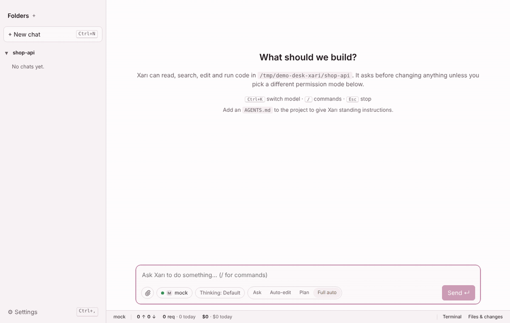
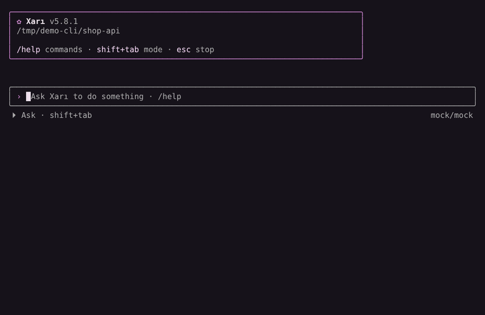
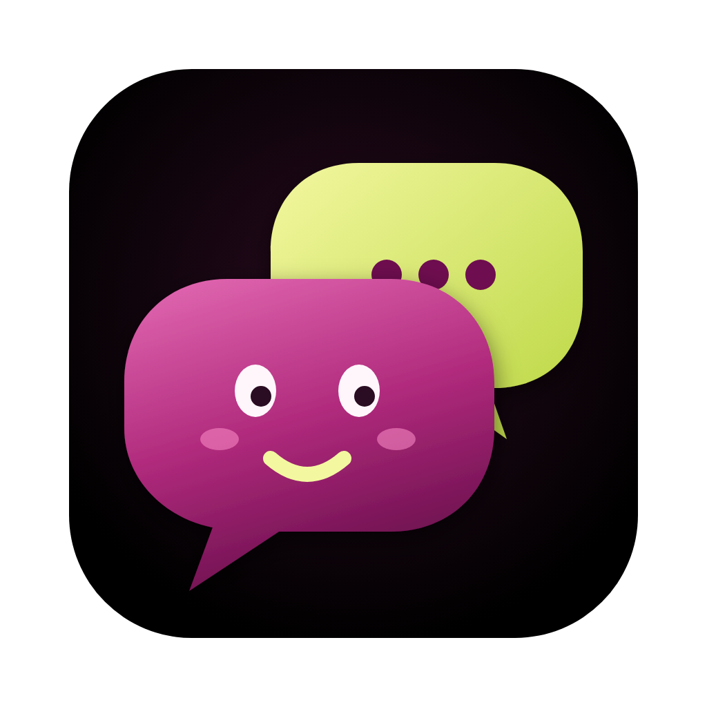
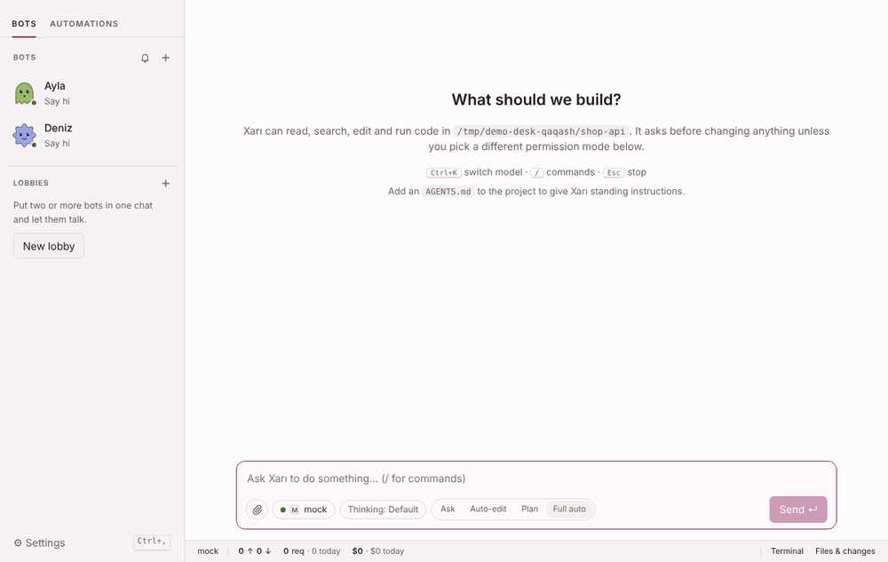

<p align="center"></p>

# Xarı

**An open-source coding agent that speaks Azerbaijani, Turkish and Russian.** It works with any model, including your own Synapse server or a local one, in a desktop app and in the terminal.



*Xarı bülbül* is a flower from Karabakh. The app is called Xarı (formerly Xarı Bülbül; the repo and the data folder keep the old name, so nothing moves for existing users).

## Why Xarı

- **Your language, everywhere.** The desktop app and the terminal CLI both speak English, Azerbaijani, Turkish and Russian.
- **Any model.** OpenRouter, Ollama Cloud, Google AI Studio (Gemini), Anthropic, OpenAI, Mistral, xAI, Groq, Cerebras, NVIDIA, Z.ai, Samanyolu AI Synapse, or any OpenAI-compatible API (local Ollama, LM Studio, vLLM). With a ChatGPT Plus or Pro plan, use **Continue with ChatGPT** instead of an API key. Switch models mid-chat with ⌘/Ctrl+K.
- **You stay in control.** Four permission modes (Ask, Auto-edit, Plan, Full auto). Destructive commands such as `rm` or `git reset --hard` always ask, even in Full auto. You can **undo a turn's changes** in one step.
- **Desktop and terminal share everything.** The same chats, settings, memory and usage. Start in one, continue in the other.
- **Runs in CI.** A [GitHub Action](docs/github-action/README.md) reviews pull requests or fixes tests with the same agent.
- **Open source, MIT.** The engine is small, readable TypeScript with no agent framework and no AI SDK. Built to be owned and extended.

## Get it

### Desktop (macOS, Windows, Linux)

Download from [Releases](https://github.com/Parzival-Samanyolu/xari-bulbul/releases/latest):

| System | File |
|---|---|
| macOS (Apple silicon and Intel) | `.dmg` |
| Windows (x64) | `.exe` |
| Linux (x64, any distro) | `.AppImage`: `chmod +x XariBulbul-*.AppImage` and run it |

Arch Linux users can build a package from the [`PKGBUILD`](packaging/arch). The app updates itself from GitHub Releases.

### Terminal (CLI)



From source (Node 22+ and pnpm 10):

```bash
pnpm install && pnpm build:cli
node apps/cli/dist/xari.mjs                              # interactive chat in this folder
node apps/cli/dist/xari.mjs -p "summarize this repo"     # one answer, then exit
git diff | node apps/cli/dist/xari.mjs -p "review this" --mode plan
```

On a Linux server, one command installs Node 22, builds `xari`, adds swap if the machine is small, and asks for an API key:

```bash
curl -fsSL https://raw.githubusercontent.com/Parzival-Samanyolu/xari-bulbul/main/apps/cli/install.sh | sudo bash
```

Run it again to update. Options, flags, keys and shortcuts are in [apps/cli](apps/cli/README.md).

The CLI's Markdown, code and diff display uses components from [Gemini CLI](https://github.com/google-gemini/gemini-cli) (Apache-2.0). See [apps/cli/THIRD_PARTY_NOTICES.md](apps/cli/THIRD_PARTY_NOTICES.md).

## Qaqaş, the bots app



**Qaqaş** ("brother" in Azerbaijani) is a second app built from the same codebase and engine. It has bots and group chats, WhatsApp and iMessage, and automations that read your email and notes and draft replies for you to review. It can import bots from Xarı. Each app keeps its own settings and chats.

<br clear="left">



```bash
pnpm dev:qaqash     # run Qaqaş from source
pnpm dist:qaqash    # Qaqaş installers (release/<version>/Qaqash-*)
```

## Features

<details>
<summary><b>The agent</b></summary>

- **Claude Code-style loop:** tools for read, edit (exact-match replace), write, list, glob, grep, shell, web search, web fetch and a todo list. A diff for every edit, live streaming, Stop / Esc, resumable chats.
- **Model switching:** ⌘/Ctrl+K, even mid-conversation. Opens on free models only by default; favorites and recents on top; sort by newest, name, context or price. The default model is `openrouter/free`.
- **Subagents:** wide searches and independent jobs go to subagents with a fresh context, in parallel. Only their reports come back. Set their model, how many run at once, and whether they may edit.
- **Memory:** `remember` / `forget` tools keep facts across chats. Review or delete them in **Settings › Memory**.
- **Context compaction:** long chats are summarized when the window fills. `AGENTS.md`, `HARNESS.md` and `CLAUDE.md` project instructions load automatically.
- **Several folders at once:** the sidebar lists every open folder with its chats. Background chats keep working, and you get a notification when one finishes.
- **Undo:** put back the files a turn changed, from the chat, with `/undo`, a shortcut or the changes panel.
</details>

<details>
<summary><b>Permissions and safety</b></summary>

- **Modes:** Ask / Auto-edit / Plan (read-only) / Full auto. Add allow and deny rules like `bash(npm test*)` or `edit_file(src/**)`. Writes outside the project folder always ask.
- **Destructive commands always ask:** `rm`, `git reset --hard`, force pushes and similar need approval even in Full auto, and are allowed once only.
- **Finish check:** before a turn ends, the agent checks for unfinished checklist steps and failed tool calls and must report anything it skipped.
- **Keys** are stored in the OS keychain (macOS Keychain, libsecret on Linux) or encrypted with your Windows account (DPAPI).
</details>

<details>
<summary><b>Usage and cost tracking</b></summary>

- Live in the status bar: prompt, completion and cached tokens, requests, and cost per chat and per day.
- A context-window meter, a per-model breakdown, CSV export, and per-chat or daily budgets (warn or stop).
- ChatGPT plan usage is shown at API prices. Synapse shows your plan and this week's allowance.
</details>

<details>
<summary><b>Web search</b></summary>

- **No key needed:** DuckDuckGo first, then Brave's free search when DuckDuckGo is busy. Unrelated results are rejected.
- **Free keys (optional):** Brave (2,000 searches a month) or Tavily (1,000 a month), used first in automatic mode. Add one in **Settings › Tools & extensions › Web search** or set `BRAVE_API_KEY` / `TAVILY_API_KEY`. Your own SearXNG also works.
- Searches can be limited to sites and to recent results. `web_fetch` returns a page as Markdown, in parts for long pages.
</details>

<details>
<summary><b>MCP servers, skills and extensions</b></summary>

- **MCP:** connect local (command) or remote (URL) servers in **Settings › MCP servers**. Their tools follow your permission rules as `mcp__<server>__<tool>`. GitHub's hosted server is one click: **Add GitHub**, then paste a token.
- **Skills and plugins:** a catalog with GitHub search, token estimates, on/off switches and a `/` command per skill.
- **Extensions:** your own tools (`.mjs`) and slash commands (`.md`), and any OpenAI-compatible provider. See [Extending Xarı](#extending-xarı).
</details>

<details>
<summary><b>Automations (mail, notes, review inbox)</b></summary>

Instructions that run by themselves, on a timer or when new email arrives, each in a new chat. Mail and notes are set up in Qaqaş.

- **Mail:** Gmail, Outlook or your own domain (IMAP/SMTP with an app password, kept in the OS keychain). Tools: `mail_search`, `mail_read`, `mail_draft`.
- **Notes:** an Obsidian vault, Apple Notes (macOS) or Notion, read with `notes_search` and `notes_read`. Nothing is ever changed.
- **Inbox:** every run is listed with its summary. Emails the agent wrote wait there to send, edit or skip.
- **Sending, per automation:** wait for your review (the default), or send automatically within per-run and per-day limits. Nothing goes to the blocklist.
- **Disclose AI:** a button on drafts adds a disclosure line; the default is per automation and the text is editable.
- **Chained actions:** when a run ends, notify you on the desktop, WhatsApp or iMessage, and start another automation.
- **Templates:** customer follow-ups, replies to new customer emails, birthday greetings, a morning inbox digest.
</details>

<details>
<summary><b>Settings</b></summary>

Providers and keys, models (defaults, per-model overrides, reasoning effort), agent (custom instructions, system prompt override, compaction, timeouts, shell), tools, usage, appearance and language, and settings import/export for your team.
</details>

## Quick start (from source)

Requires Node 22+ and pnpm 10.

```bash
pnpm install
pnpm dev          # launches the desktop app with hot reload
```

1. Open **Settings › Providers › API keys** and paste an [OpenRouter](https://openrouter.ai/keys), [Ollama Cloud](https://ollama.com/settings/keys) or [Google AI Studio](https://aistudio.google.com/apikey) key. It is tested as soon as you save it.
2. Open a project folder and start asking.

| Shortcut | Action |
|---|---|
| ⌘/Ctrl+K | Model switcher |
| ⌘/Ctrl+N | New chat |
| ⌘/Ctrl+, | Settings |
| Shift+Tab | Cycle permission mode |
| Esc | Stop the agent |
| `/` | Slash commands (`/compact`, `/clear`, `/model`, `/mode`, `/undo`, plus yours) |

To keep a development profile separate from your real one:

```bash
HARNESS_DATA_DIR=/tmp/harness-dev pnpm dev
```

## Extending Xarı

Extensions live in `~/.harness/` (yours, applied to every project) or `<project>/.harness/` (per project):

```
.harness/
├─ tools/       *.mjs  → new tools the model can call
└─ commands/    *.md   → slash commands (/name), with $ARGUMENTS substitution
```

See [`examples/extensions`](examples/extensions) for a working tool and two commands. Reload them from **Settings › Tools & extensions › Extensions**.

Project *tool code* only loads if you enable it in settings, because opening a cloned repo shouldn't run its code. Project commands, which are plain markdown, always load.

To add a provider, go to **Settings › Providers › Custom endpoints**, choose **Add endpoint** and enter any OpenAI-compatible base URL, such as:
- local Ollama: `http://localhost:11434/v1`
- LM Studio
- DeepSeek
- vLLM

## Project layout

```
packages/core/          the engine: no UI, fully tested
  src/providers/        OpenAI-compatible streaming adapter, SSE parser, model registry
  src/loop/agent.ts     the agent loop (events, permissions, tool execution, compaction)
  src/tools/            one file per built-in tool
  src/permissions/      modes + allow/deny rule matching
  src/usage/            token/request/cost tracking and budgets
  src/sessions/         chat persistence
  src/context/          system prompt, project instructions, compaction
  src/extensions/       user tools and slash commands
  src/mcp/              MCP client: connects servers, adapts their tools
  src/memory/           facts saved across chats
  src/settings/         the settings schema (zod) with defaults
apps/desktop/           Electron app, built as two editions (src/shared/edition.ts): Xarı and Qaqaş
apps/cli/               the `xari` terminal app: host, arguments, Ink UI (src/ui), non-interactive mode, install.sh
bench/                  model benchmark: tasks, runner, published results
```

To add a built-in tool, create one file in `packages/core/src/tools/` using `defineTool(...)` and register it in `tools/index.ts`.

## Tests

```bash
pnpm test         # vitest: engine (mock provider, prompt snapshots, headless runs)
pnpm typecheck
```

## Model benchmark

[`bench/`](bench) runs agent tasks (coding, tool use, GitHub MCP) through the real engine and checks the results. See [the latest results](bench/README.md#latest-results), also published as the Hugging Face dataset [Parizival/xari-bulbul-bench](https://huggingface.co/datasets/Parizival/xari-bulbul-bench). Run `pnpm bench` to benchmark your own favorite models.

## Building installers and releasing

```bash
pnpm dist         # builds installers for the current OS into apps/desktop/release/
```

Pushing a tag like `v0.1.0` runs `.github/workflows/release.yml`. It builds on macOS, Windows and Linux and publishes these files to a GitHub Release, which installed apps auto-update from:
- macOS: `.dmg` (plus the `.zip` the updater installs from)
- Windows: `.exe`
- Linux: `.AppImage`
- the `latest*.yml` files the updater reads

On Arch Linux, the `PKGBUILD` in [`packaging/arch`](packaging/arch) repackages the AppImage.

Builds are **unsigned** until you add signing secrets (see the comments in the workflow). Without signing:
- On macOS, right-click the app and choose **Open** the first time.
- On Windows, SmartScreen asks you to click **More info → Run anyway**.

## Roadmap

- OAuth sign-in for remote MCP servers
- Hooks
- Sandboxed shell
- Code signing
- Team settings sync

## Credits

The logo is an edit of a public-domain photo of *Ophrys caucasica* by Nuvens on Wikimedia Commons. See [docs/brand](docs/brand/README.md).

## License

MIT
